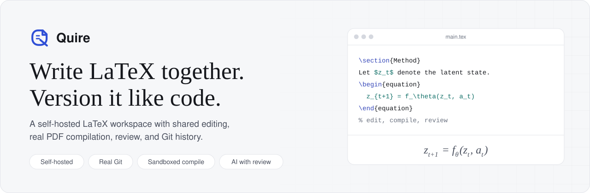
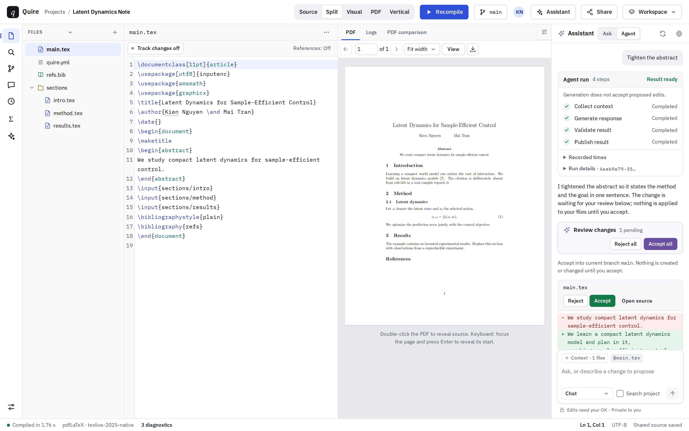

<p align="center">
  <a href="https://knn-07.github.io/Quire/">
    <picture>
      <source media="(prefers-color-scheme: dark)" srcset="docs/images/banner-dark.svg">
      <source media="(prefers-color-scheme: light)" srcset="docs/images/banner-light.svg">
      
    </picture>
  </a>
</p>

<p align="center">
  <a href="https://github.com/KNN-07/Quire/actions/workflows/ci.yml"></a>
  <a href="https://github.com/KNN-07/Quire/actions/workflows/pages.yml"></a>
  
  
  
  
  
</p>

<p align="center">
  <a href="https://knn-07.github.io/Quire/"><strong>Website</strong></a> ·
  <a href="https://knn-07.github.io/Quire/docs.html"><strong>Documentation</strong></a> ·
  <a href="https://knn-07.github.io/Quire/self-hosting.html"><strong>Self-hosting</strong></a> ·
  <a href="https://knn-07.github.io/Quire/security.html"><strong>Security</strong></a> ·
  <a href="docs/feature-matrix.md"><strong>Project status</strong></a>
</p>

<p align="center">
  <a href="https://knn-07.github.io/Quire/"></a>
</p>

<p align="center"><em>The running application with a seeded example project and its compiled PDF.</em></p>

## Why Quire

Quire is for research teams who want an Overleaf-style editor on infrastructure
they control. Co-authors who live in source and co-authors who never want to see
a backslash work in the same file. Every project is a real Git repository, and
AI is optional: writing and compilation work without it.

## Features

<table>
  <tr>
    <td width="50%" valign="top">
      <h3>Write and preview</h3>
      Source, Visual, Split, and PDF layouts. Syntax highlighting, project
      search, symbols, tables, figures, and compile diagnostics linked back to
      the source.
    </td>
    <td width="50%" valign="top">
      <h3>Collaborate</h3>
      Shared editing with role-based permissions, comments, review suggestions,
      and tracked changes.
    </td>
  </tr>
  <tr>
    <td valign="top">
      <h3>Real Git</h3>
      Clone, branch, commit, and push. Review changes before you commit, label
      versions, and restore earlier work.
    </td>
    <td valign="top">
      <h3>Isolated compilation</h3>
      pdfLaTeX, XeLaTeX, and LuaLaTeX run in sandboxed workers with no network
      access. There is no unsandboxed fallback.
    </td>
  </tr>
  <tr>
    <td valign="top">
      <h3>References</h3>
      Bibliography editing, DOI and library imports, configured reference
      search, and opt-in inline citation completion.
    </td>
    <td valign="top">
      <h3>AI with review</h3>
      Ask questions or give the agent a task. It proposes a diff, and nothing
      changes in your source until you accept it.
    </td>
  </tr>
  <tr>
    <td valign="top">
      <h3>Projects and templates</h3>
      Start blank, pick a template, or import a ZIP. Export your source at any
      time.
    </td>
    <td valign="top">
      <h3>Run your own workspace</h3>
      Accounts and organizations, SAML, OIDC and LDAP sign-in, provider
      configuration, signed backups, and compiler workers.
    </td>
  </tr>
</table>

## Quick start

You need **Bun 1.4.4**, **Node.js** `^20.19.0 || >=22.12.0`, and **Git**.
Compiling PDFs natively also needs **Linux** with TeX tools, SyncTeX, Poppler,
Bubblewrap, and a working systemd user service. Install both BibTeX and Biber
for the default `bun run doctor` readiness check. See the
[toolchain guide](docs/runbooks/toolchains.md).

```sh
git clone https://github.com/KNN-07/Quire.git
cd Quire
bun install
bun run db:migrate
bun run seed
bun run doctor
bun run dev
```

Open **`http://localhost:5173`** and sign in as **`kien@quire.local`** with the
password printed by `bun run seed`. Create a blank project or choose the
**Starter Article** template. The development operator is
`operator@quire.local`, with the same initial password.

<details>
<summary>More on local setup</summary>

- The development server proxies the API at `http://127.0.0.1:3001`. Project
  data is stored in `.data` by default.
- To choose the initial password:
  `QUIRE_SEED_PASSWORD='your-local-password-at-least-12-characters' bun run seed`
- Seeding preserves existing passwords and projects. These accounts are for
  local development; configure production identity separately.
- The first compiler readiness check can take about 45 seconds.
- The install includes a repository-local Bun binary. Use the package scripts or
  `./node_modules/.bin/bun` so an older global Bun is not used by accident.

</details>

## Deploy

The development command is not a production installation. Pick a profile and
follow its guide. Start with [`.env.example`](.env.example); when you override
`QUIRE_DATA_DIR`, use the same directory for migration, seeding, startup, and
diagnostics.

| Profile | Storage | Guide |
| --- | --- | --- |
| **Local** | SQLite, local blobs, Git repositories | [Deployment](docs/runbooks/deployment.md) |
| **Portable** | PostgreSQL, Redis, S3-compatible storage | [Portable profile](deploy/portable/README.md) |
| **Managed installation** | Signed releases with status, rollback, and recovery | [Installation](docs/runbooks/installation.md) |

Install commands for native, Docker Compose, and Kubernetes are on the
[self-hosting page](https://knn-07.github.io/Quire/self-hosting.html).

AI, reference, identity, mail, storage, and billing services are optional and
need their own configuration and credentials. ReadCube and Dimensions are not
available.

## Documentation

| Topic | Where |
| --- | --- |
| Getting started and configuration | [Documentation site](https://knn-07.github.io/Quire/docs.html) |
| Compiler toolchains and workers | [toolchains](docs/runbooks/toolchains.md), [workers](docs/runbooks/workers.md) |
| Providers and integrations | [adapters](docs/runbooks/adapters.md), [SSH Git bridge](docs/runbooks/ssh.md) |
| Backups, recovery, and updates | [recovery](docs/runbooks/recovery.md), [updates](docs/runbooks/updates.md) |
| Operations and support | [operations](docs/runbooks/operations.md), [support](docs/runbooks/support.md) |
| Privacy | [privacy](docs/runbooks/privacy.md) |

## Development

```sh
bun run typecheck
bun run lint
bun run build
bun run verify:matrix
```

Run the tests relevant to your change. For example:

```sh
./node_modules/.bin/bun test tests/contract
./node_modules/.bin/bun test tests/adapters/ai
```

Browser checks use Playwright, and compilation scenarios need the native
toolchain. `bun run ops:restore-drill` checks local recovery in temporary
fixtures without touching a live installation.

**Built with** React, TypeScript, CodeMirror, Yjs, PDF.js, Vite, and Bun. The
interface lives in `apps/web`, the server in `apps/server`, domain services in
`services`, and isolated compilation in `workers/compiler`.

## Project status

Quire is in active development. Core writing and collaboration workflows are
implemented; some administration, accessibility, and integration work remains.
The [feature matrix](docs/feature-matrix.md) records what is available and what
is not.

## Security

How Quire handles sessions, compilation, and credentials is described on the
[security page](https://knn-07.github.io/Quire/security.html). Please report
vulnerabilities privately and avoid opening a public issue for anything
exploitable.
