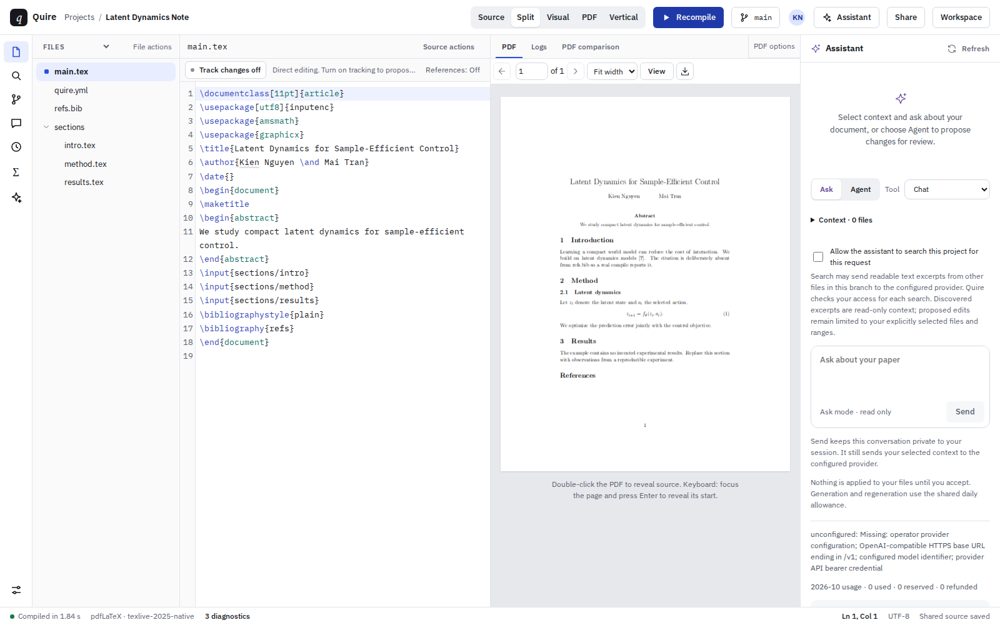

# Quire

A self-hosted LaTeX workspace for writing, collaboration, and real PDF
compilation. Edit source or use the visual editor, review changes with your
team, and keep files, references, and project history together.



*The running application with a seeded example project and its actual compiled PDF.*

## Features

- **Write and preview:** Source, Visual, split, and PDF layouts; syntax
  highlighting, project search, symbols, tables, figures, and source-linked
  compile diagnostics.
- **Keep your work:** Persistent projects and files, blank/template creation,
  ZIP import and source export, labeled history, restore, and native Git tools.
- **Collaborate:** Shared editing, role-based permissions, comments, review
  suggestions, and tracked changes.
- **Manage references:** Bibliography editing, DOI/library imports, configured
  reference search, and opt-in inline citation completion.
- **Use AI with review:** Ask/Agent and language tools, explicit context
  selection, opt-in authorized project search, and proposals that require
  acceptance before changing source.
- **Run your own workspace:** Account and organization controls, provider
  configuration, backups, compiler workers, and operational administration.

Your workspace runs on your own infrastructure. AI and connected services use
providers you configure; they are optional, not required for ordinary writing
and compilation.

## Run locally

### Requirements

- **Bun 1.4.4**, the repository's pinned runtime.
- **Node.js** compatible with Vite 7: `^20.19.0 || >=22.12.0`.
- **Git** for project repositories.
- For native compilation: **Linux**, TeX tools, BibTeX/Biber, SyncTeX,
  Poppler, Bubblewrap, and a working systemd user service/cgroup environment.
  See the [toolchain guide](docs/runbooks/toolchains.md) for setup and probes.

```sh
git clone https://github.com/KNN-07/Quire.git
cd Quire
bun install
bun run db:migrate
bun run seed
bun run doctor
bun run dev
```

Open **`http://localhost:5173`**. The development server proxies the API at
`http://127.0.0.1:3001`; project data is stored in `.data` by default.

Sign in as **`kien@quire.local`** with the password printed by `bun run seed`.
Create a blank project or choose the published **Starter Article** template.
The development operator is `operator@quire.local`, using the same initial
seed password.

To choose the initial development password:

```sh
QUIRE_SEED_PASSWORD='your-local-password-at-least-12-characters' bun run seed
```

Seeding preserves existing passwords and projects. These accounts are for local
development; configure production identity separately. The first compiler
readiness check can take roughly 45 seconds.

The install includes a repository-local Bun binary. Use package scripts or
`./node_modules/.bin/bun` after installation to avoid accidentally testing with
an older global runtime.

## Configuration and deployment

Start with [`.env.example`](.env.example). When overriding `QUIRE_DATA_DIR`,
use the same directory for migration, seeding, startup, and diagnostics.

The local profile uses SQLite, local blobs, and Git repositories. A portable
PostgreSQL/Redis/S3 profile and separately managed compiler workers are also
available. Read the profile-specific instructions rather than treating the
development command as a production installation:

| Guide | Purpose |
| --- | --- |
| [Deployment](docs/runbooks/deployment.md) | Configuration, startup, and deployment boundaries |
| [Compiler toolchains](docs/runbooks/toolchains.md) | Native tools, isolation, and environment readiness |
| [Portable profile](deploy/portable/README.md) | PostgreSQL, Redis, S3-compatible storage, and worker setup |
| [Managed installation](docs/runbooks/installation.md) | Provisioning, signed releases, status, rollback, and recovery |

The production build writes application and worker artifacts to `dist`.
External AI, reference, identity, mail, storage, and billing services require
their own configuration and credentials. ReadCube and Dimensions are not
currently available.

## Development and checks

```sh
bun run typecheck
bun run lint
bun run build
bun run verify:matrix
```

Run the relevant tests for a change. For example:

```sh
./node_modules/.bin/bun test tests/adapters/ai
./node_modules/.bin/bun test tests/ui-editor/acceptance/native-editor.browser.test.ts
```

Browser checks use Playwright; compilation scenarios also need the native
toolchain above. `bun run ops:restore-drill` checks local recovery in temporary
fixtures without restoring a live installation.

### Built with

React, TypeScript, CodeMirror, Yjs, PDF.js, Vite, and Bun. The interface lives in
`apps/web`, the server in `apps/server`, domain services in `services`, and
isolated compilation in `workers/compiler`.

## Project status

Quire is actively developed. Core writing and collaboration workflows are
implemented; some advanced administration, accessibility, and integration
work remains. See the [feature matrix](docs/feature-matrix.md) for detailed
availability and known limitations.
